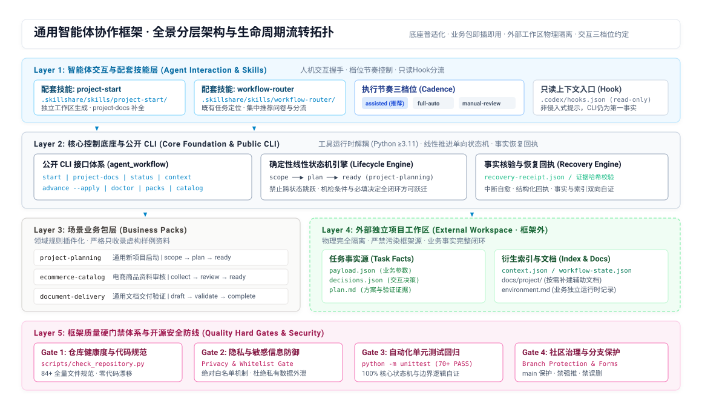

# 04-框架全景流程与发布核对清单

> 本文档面向所有使用与维护本框架的开发者、架构师与 AI 智能体。
> 包含两项核心使命：
> 1. **全景认知**：向使用者完整展示框架分层架构、端到端生命周期工作流与核心能力体系；
> 2. **标准核对规程**：在**更新框架/业务包版本之前**以及**正式向社区或平台发布上线之前**，提供可逐项打勾执行的标准核对清单（Checklist）。

---

## 一、框架核心功能矩阵

本框架面向高可靠人机协作与智能体任务流转场景设计，为复杂任务从脚手架创建到业务落地提供全生命周期工程约束与质量防护：

| 功能模块 | 核心能力 | 对应工具 / 载体 | 核心价值 |
|---|---|---|---|
| **脚手架与独立工作区** | 标准化创建独立项目、辅助文档按需补建 | `start` / `project-docs` / `project-start` | 确保业务项目在框架仓库外物理隔离，不污染通用开源底座 |
| **通用线性状态机** | 确定性状态跃迁与机检闭环 | `advance --apply` / 状态机引擎 | 杜绝智能体跨阶段幻觉跃迁，严格单向推进 |
| **事实源与衍生索引解耦** | 任务参数、交互决定与方案真源存储 | `payload.json` / `decisions.json` / `context` | 事实不可变，索引可随时重建，保障系统极端中断可自愈 |
| **交互三档位执行节奏** | 汇报频次与确认时机约定 | `assisted` (默认) / `full-auto` / `manual-review` | 减少无意义打扰，同一时点推荐一次性呈现，禁止猜测答案 |
| **业务环境独立性** | 工具 Python 与业务项目运行时正交 | `ADR 0005` / `environment.md` | 不强制预设业务语言或环境，不更改系统代理或 VPN |
| **四道质量硬门禁** | 代码规范、隐私脱敏、回归单测与分支保护 | `check_repository.py` / GitHub Branch Rules | 离线确定性防御，100% 自动化测试保障框架稳定性 |

---

## 二、框架全景生命周期与分层架构

### 1. 全景分层架构拓扑


> 💡 **交互式全景图元**：以上架构图完整交互式网页版本见 [framework-architecture-and-lifecycle.html](diagrams/framework-architecture-and-lifecycle.html)。

### 2. 经典项目启动状态机流转 (project-planning)

```text
 ┌───────────────┐
 │   Stage 0     │ 脚手架创建与初始握手 (Kickoff)
 │   Kickoff     │ -> 运行 start 生成框架外项目工作区骨架与首个规划任务
 └───────┬───────┘
         ▼
 ┌───────────────┐
 │   Stage 1     │ 范围与边界定义 (Scope)
 │    Scope      │ -> 明确使用者、边界、排除项与成功指标，持久化至 payload.json
 └───────┬───────┘
         ▼
 ┌───────────────┐
 │   Stage 2     │ 方案设计与集中问卷 (Plan)
 │    Plan       │ -> 编写 plan.md，架构与环境等未决项整合成集中推荐问卷 (decisions.json)
 └───────┬───────┘
         ▼
 ┌───────────────┐
 │   Stage 3     │ 启动就绪与无缝交接 (Ready)
 │    Ready      │ -> 机检全过、决定全闭环；原交办包含后续实现的直接无缝继承档位推进
 └───────────────┘
```

### 各阶段输入、产出与推进命令对照

| 阶段 | 初始状态 | 目标状态 | 核心任务 | 关键产出文件 | 推进命令 / 门禁 |
|---|---|---|---|---|---|
| **0. 启动** | - | `scope` | 创建外部工作区、生成首个规划任务与项目入口 | `AGENTS.md`, `project.json` | `agent_workflow start <dir> --apply` |
| **1. 范围** | `scope` | `plan` | 录入并核验项目业务边界、排除项与成功标准 | `payload.json`, `context.json` | `advance <dir> --apply`（机检项通过） |
| **2. 方案** | `plan` | `ready` | 设计实施路径，向用户呈现单选/推荐决定问卷 | `plan.md`, `decisions.json` | 集中决策确认 + `advance --apply` |
| **3. 就绪** | `ready` | 交接执行 | 方案与契约就绪，按原交办范围继承档位无缝交接 | `workflow-state.json` | 自动衔接业务实现与环境落地 |

---

## 三、人机交互前置确认与问卷导航规程

为避免开发者或智能体在缺少关键边界前主观推测业务方案，框架推行人机**“集中问卷 + 推荐驱动”**机制：

### 1. 任务启动前置确认（固定必答项）

| 序号 | 核心问题项 | 标准化选项 / 沟通内容 | 约束与影响 |
| :--- | :--- | :--- | :--- |
| **1.1** | **工作区物理位置** | • 必须位于框架仓库目录外部，且目录尚不存在<br>• 建议标准英文 slug 作为 project-id | 绝对物理隔离，防止源码污染 |
| **1.2** | **执行节奏档位** | • A. **assisted**（推荐：连续处理已交办本地工作，集中提问未决项）<br>• B. **full-auto**（全自动机检，遇未决业务决策立即安全停下）<br>• C. **manual-review**（实质本地写入前均暂停展示 diff） | 单次确认持久化，后续中断自动恢复 |
| **1.3** | **交办范围闭环** | • A. **仅启动规划**（推进至 `ready` 状态后停下交接）<br>• B. **启动并实现**（`ready` 达成后无缝接管，按原档位直接推进实现） | 严禁已交办目标重复向用户索取授权 |

### 2. 方案评审集中问卷规范

在 `plan` 阶段，严禁将“运行时版本”、“数据库选型”、“部署入口”拆解为数十个单步提问：
1. 智能体必须在 `plan.md` 中完整梳理候选方案并形成明确**推荐（Recommended）**；
2. 将所有未决业务决定汇总于单次问题列表中；
3. 用户回复“按推荐”后，一次性将决定写入 `decisions.json` 并推进状态。

---

## 四、版本更新前与发布上线硬核对清单（Checklist）

在向远程仓库推送、合并分支或发布新版本前，必须严格完成以下核对：

### 1. 代码质量与全量测试门禁

- [ ] 运行全量单元测试：`python -m unittest discover -s tests`，所有测试 100% 通过（无 error、无 failure）。
- [ ] 运行仓库综合门禁：`python scripts/check_repository.py`，确保：
  - [ ] 隐私门禁无敏感信息泄漏，白名单符合规范；
  - [ ] 代码规范检查 0 告警；
  - [ ] 84+ 核心文件无缺失、无破损。

### 2. 文档与架构资产同步

- [ ] 根目录 `CONTEXT.md` 领域模型词汇表已同步最新术语。
- [ ] 系统决策记录 `docs/adr/` 已归档不可逆设计决定。
- [ ] 架构设计图元 `docs/00-入口层/diagrams/` 结构与最新代码一致。
- [ ] 配套技能文档 `docs/agents/workflow-skills.md` 与 `.skillshare/` 技能源保持一致。

### 3. 开源社区与分支治理

- [ ] 根目录具备标准开源文件：`LICENSE` (MIT), `CONTRIBUTING.md`, `CODE_OF_CONDUCT.md`, `SECURITY.md`。
- [ ] `.github/ISSUE_TEMPLATE/` 包含标准 Issue 表单与 `pull_request_template.md`。
- [ ] GitHub 远端 `main` 分支已开启分支保护规则（禁止强推 `allow_force_pushes=false`、禁止分支删除 `allow_deletions=false`）。
- [ ] 仓库公开可见性（Visibility: Public）核实正常。
